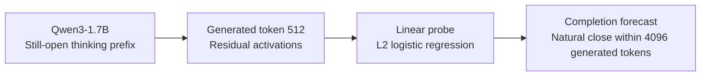

# Thinking Completion Probes

Can a small linear probe of a reasoning model's internal state forecast whether
its ongoing thinking will naturally finish before a token limit?

Dataset: [mangesh-ux/thinking-completion-probes on Hugging Face](https://huggingface.co/datasets/mangesh-ux/thinking-completion-probes)
— the unchanged verified numerical release, with a dataset card, checksums and
a [CPU verification/reproduction example](docs/huggingface/README.md#cpu-reproduction).

This repository provides a reproducible **exploratory study**, not a deployed
early-exit method. At a 512-token reasoning checkpoint in Qwen3-1.7B, adding one
layer's residual activation to confidence and lexical controls improved held-out
completion-forecast log loss by **0.0553 nats per problem** (problem-cluster 95%
interval **0.0212–0.0888**). It did **not** demonstrate correct-answer recovery,
causal reasoning understanding, or inference-cost savings.

## Why this matters

Thinking-phase completion is a different question from answer correctness.
Forecasting whether still-open reasoning will close before a token cap could
help researchers characterize truncation and investigate how models use their
reasoning budgets. It also provides a measurable endpoint for future
compute-allocation or stopping-policy studies. Here we test only whether
activations improve that forecast beyond the specified controls—not how many
tokens remain, or whether stopping would preserve accuracy or save compute.



The primary probe combines activations with confidence and lexical controls;
its layer and regularization are selected on TRAIN only. Completion is not
correctness.

## Two questions, two outcomes

The original experiment asked whether activations predict **wrong→correct answer
recovery**, beyond confidence. Collection finished, but the answer measurement
and reference-evaluation endpoint did not yield eligible wrong→correct/wrong→wrong
comparisons. That question is **non-evaluable**, not a negative activation result.

The completed follow-up reused existing prefixes, activations and confidence
features, with no new GPU inference, to forecast **natural thinking completion**:
will the model emit its first `</think>` within the 4096-token budget? Closing
thinking is observable but is **not equivalent to getting the answer right**.
The follow-up is exploratory; original validation was held out during fitting
and selection, and the original 32-problem test split remains unused.

## Reproduce

Python **3.12** is required. Commands below work on Linux/macOS; on Windows use
`.venv\Scripts\python.exe` and `.venv\Scripts\Activate.ps1` in place of activation.
No command provisions a cloud resource.

```bash
python -m venv .venv
source .venv/bin/activate
python -m pip install -e .
tcp verify
```

This first check uses only the standard library and checks the bundled report's
internal consistency. **It is not an empirical reproduction.**

For numerical verification and full CPU refitting:

```bash
python -m pip install -r requirements/cpu.txt -r requirements/dev.txt
tcp download --destination data/release-v1
tcp verify --bundle data/release-v1
tcp reproduce --bundle data/release-v1 --output runs/reproduction-v1
python -m pytest
```

The release contains anonymized numerical inputs, all 28 activation layers,
stored TRAIN folds, frozen model states and paired validation predictions.
Download verifies an independently pinned archive and manifest SHA256 before
extraction. `verify --bundle` restores every frozen model and recomputes all
reported metrics and intervals. `reproduce` refits **640 grouped-CV fits plus five
final TRAIN models**, selects the layer on TRAIN only, and evaluates the fixed
validation inputs once. Outputs are write-once; use a new run name for an
intentional independent reproduction. Do not overwrite a failed run.

See [reproducibility and verification scope](docs/reproducibility.md),
[future GPU regeneration](docs/regeneration.md), and
[release/privacy policy](docs/release_policy.md). Runtime/version or checksum
failures are blocking, not permission to change the historical procedure.

## Experimental design

We used [Qwen/Qwen3-1.7B](https://huggingface.co/Qwen/Qwen3-1.7B/tree/70d244cc86ccca08cf5af4e1e306ecf908b1ad5e)
in BF16, and a fixed difficulty-7/8 cohort from
[DeepMath-103K](https://huggingface.co/datasets/zwhe99/DeepMath-103K/tree/5cf055d1fe3d7a2eb19719ac020211469736ae44).
The answer-independent cohort contains 160 problems, grouped into 96 TRAIN,
32 validation and 32 unused test problems. Six seeded stochastic trajectories
per TRAIN/validation problem produced 576/192 rows respectively.

The forecast is conditional on an available, still-open **512-token prefix**.
Positive: first natural close starts at or after that checkpoint and within the
4096-token generation. Negative: genuinely reaches the full cap without closing.
Already-closed, short, failed or unknown-termination rows are exclusions, not
negative examples. Historical TRAIN/validation had no primary-checkpoint attrition.

Activations are the **post-transformer-block residual at the last prefix token**,
before final normalization: 28 layers × 2048 coordinates. Extraction reruns the
exact prompt and saved prefix **without an answer cue**. BF16 values are stored
losslessly as float32 for CPU work. Confidence measurements use separate greedy,
64-token, counterfactual answer readouts; their flaws remain part of this baseline.

| Model | Predictors |
|---|---|
| A | Checkpoint coordinates, problem-token count, difficulty, TRAIN topic vocabulary |
| B | A + seven frozen readout confidence/agreement features |
| Blex | B + 512 hashed counts of the last 128 prefix tokens |
| C | B + one selected layer's 2048 residual coordinates |
| Clex | Blex + the same residual layer; primary comparison versus Blex |

Each model is an L2-regularized logistic regression. Missingness, medians,
topic vocabulary, variance filtering and weighted standardization are learned
only from each TRAIN fit partition. Five problem-grouped, difficulty-stratified
TRAIN folds select regularization from `{0.001, 0.01, 0.1, 1}` and the primary
layer among all 28 layers. Ties favor stronger regularization then shallower
layers. C uses the Clex-selected layer and selects only its own regularization.
The selected layer is zero-based **15** (block 16); every selected C is **0.001**.

## Results

The unit of weighting and uncertainty is the **problem**, not an independent
rollout. Lower log loss/Brier is better; higher average precision/ROC-AUC is better.

| Model | Log loss (nats) | Brier | Average precision | ROC-AUC |
|---|---:|---:|---:|---:|
| TRAIN prevalence | 0.6651 | 0.2347 | 0.3490 | 0.5000 |
| A | 0.6606 | 0.2329 | 0.4591 | 0.5906 |
| B | 0.6609 | 0.2331 | 0.4498 | 0.6054 |
| Blex | 0.6687 | 0.2364 | 0.3826 | 0.5667 |
| C | 0.5940 | 0.2057 | 0.6398 | 0.7379 |
| Clex | 0.6134 | 0.2141 | 0.5415 | 0.7053 |

The predeclared primary comparison is **Clex versus Blex**, not a post-hoc choice
of the best table row. Secondary C versus B improves log loss by 0.0669 nats
(95% interval 0.0249–0.1075). Lexical Blex versus B does not improve it: −0.0078
(−0.0364–0.0202).

Within the 17 validation problems containing both outcomes, Clex's
positive-versus-negative concordance is 0.5358 versus Blex's 0.4047;
paired difference 0.1310 (0.0044–0.2683). The absolute concordance is modest,
the support small and the interval wide.

Intervals use 2000 paired problem-cluster resamples, preserving repeated
sampled problems. They condition on fixed trained models: **no training/selection
uncertainty**, and no secondary multiplicity correction. Exact values and source
hashes are in [the machine-readable reference](src/thinking_completion/reference/historical_v1.json).

## Interpretation and limits

The result supports incremental predictive utility of a residual state for
this bounded completion endpoint, relative to the specified controls—not new
information absent from the tokens. It does not
show that the probe understands mathematical correctness, or that using it to
stop inference would preserve accuracy. The reference/parser problem also blocks
claims about recovery in the original experiment.

Features were recomputed from prefix information after the original trajectories
had been collected: they are **prefix-information-only, not prospectively
timestamped pre-outcome online measurements**. The lexical control is weak, not
a universal language baseline. One model, one BF16 backend, two difficulty strata,
one checkpoint, a capped horizon and only 32 held-out validation problems limit
generalization. See [methodology and risks](docs/methodology.md).

## Engineering and extension

`src/thinking_completion/` separates numerical release validation, generation,
feature extraction, preprocessing/selection, metrics and delivery. Configurations
are pinned in `configs/`; synthetic tests cover leakage boundaries, grouping,
missingness, stored folds, serialization, termination and safe artifact loading.
CI runs CPU-only tests and report checks. Generated benchmark text and traces
remain in ignored private `artifacts/`; no model weights or original identities
are published. Numeric anonymity is not a formal privacy guarantee.

Future work could preregister a genuine untouched held-out completion replication,
stronger lexical controls or additional checkpoints/models, then separately
repair and validate answer measurement before returning to correctness recovery.
Each would be a new versioned study, not a retuning of this result. No such new
study or paid run is launched by this repository's publication process.

Historical authority: [reasoning-recovery-probes at the completed study commit](https://github.com/mangesh-ux/reasoning-recovery-probes/tree/27ecb795ea8194a5fe3c3d603a6b775e7f705088).
Code and newly authorized numeric derivatives: MIT; third-party terms remain
separate. Citation metadata: [CITATION.cff](CITATION.cff).
